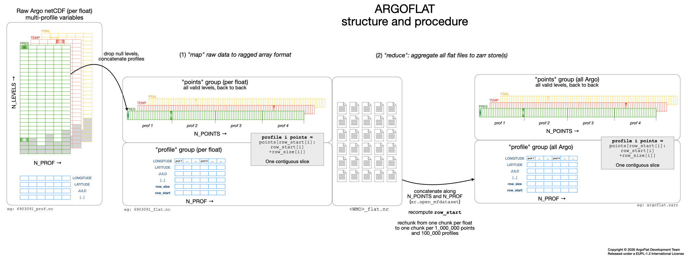

# ARGOFLAT: The Argo dataset as a lossless, analysis-ready, cloud-optimized contiguous ragged array
A simple solution to enable fast random access to Argo profiles and ML-ready batch sampling from a global aggregate.

‼️ Work in progress ‼️

Our full Argo dataset is currently build with the entire GDAC pressure, temperature and salinity data (BGC data will follow).

The full (expert) dataset:
- has: 20_565 floats, 3_418_235 P/T/S profiles and 1_360_094_341 measurement points.
- is about 11 GB, as one or more zarr stores.
- is available for testing in 3 versions:
  - As a single zarr store (~10.8 GB)
  - As a collection of 11 zarr stores (~1 GB) with about 2000 floats each
  - As a collection of 21 zarr stores (~500 MB) with about 1000 floats each 
- is available for testing through 3 protocoles: local, https, s3.

A derived version following the AST/ADMT guideline to select Argo measurements suitable for research is also available (See [What is the difference between an 'R' and a 'D' profile file?](https://argo.ucsd.edu/data/data-faq/)):
- has: 15_354 floats, 2_255_098 P/T/S profiles and 936_728_750 measurement points.
- is about 4.5 GB.
- is available for testing in 1 version:
  - As a single zarr store (~4.5 GB)
- is available for testing through 3 protocoles: local, https, s3.

The ARGOFLAT collection of datasets basically follow the Argopy user modes:
- 🏄 *expert* mode return all the Argo data, without any postprocessing
- 🚣 *research* mode simplifies the dataset to its heart, preserving only data of the highest quality for research studies, including studies sensitive to small pressure and salinity bias (e.g. calculations of global ocean heat content or mixed layer depth).

## Basic concept



## User API

Open or connect to an ArgoFlat dataset:
```python
from argoflat import FlatData

fd = FlatData("stores/argoflat_expert.zarr")  # all floats in 1 zarr
# fd = FlatData("stores_1000/argoflat_expert_0*.zarr") # 1000 floats per zarr
# fd = FlatData("stores_2000/argoflat_expert_0*.zarr") # 2000 floats per zarr

# fd = FlatData("stores/argoflat_research.zarr")  # all floats in 1 zarr

# fd = FlatData("s3://bucket/argoflat_*.zarr", anon=True)
```

Use profile selectors similar to [Argopy access point syntax](https://argopy.readthedocs.io/en/latest/user-guide/fetching-argo-data/data_selection.html):
```python
ds = fd.region([-75., 0., 0., 45.])
ds = fd.region([-75., 0., 0., 45., '20000101', '20201231'])

ds = fd.float(1901514)
ds = fd.float([1901514, 1902284])

ds = fd.profile(1901514, [2, 3])
ds = fd.profile([1901514, 1902284], 3)
ds = fd.profile([1901514, 1902284], [2, 3])
```

Or use profile selection with standard 0-based indexing:
```python
ds = fd[100] 
ds = fd[10:20] 
ds = fd[[1, 5, 8]]
ds = fd[:] # Full dataset !
```

The xarray dataset that is returned has all profiles meta-data loaded in memory (eg: LATITUDE, LONGITUDE, etc ...) and all measurements in chunks of 1_000_000 points (e.g.: PRES, TEMP, etc...).

***
🫣 [qwen 3.8](https://huggingface.co/Qwen/Qwen3.8-27B) LLM running on Ifremer self hosted [openwebui](https://openwebui.com) was used as a debugging tool in this _shame project_. 