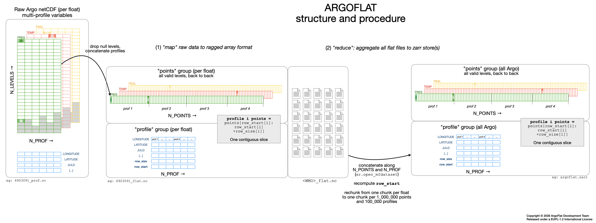

|                                                                                                                                                    <h1>ArgoFlat</h1><p>The Argo dataset as a lossless (not opinionated), analysis-ready, cloud-optimized contiguous ragged array</p>                                                                                                                                                    |
|:---------------------------------------------------------------------------------------------------------------------------------------------------------------------------------------------------------------------------------------------------------------------------------------------------------------------------------------------------------------------------------------------------------------------------------------:|
|             [](https://www.repostatus.org/#wip)            |
|                                                                                                                                                                                   [![Pypi][pip-badge]][pip-link] [![Conda][conda-badge]][conda-link]                                                                                                                                                                                    |                

A simple solution to enable fast random access to Argo profiles and ML-ready batch sampling from a global aggregate of all Argo data.

‼️ Work in progress: this is a functional prototype, but the API can change anytime without notice.

## Basic concept

In one line: 
> Argo core and synthetic multi-profile files are flatten and concatenated as 1-dimensional (ragged) chunked arrays into a zarr store.



Breakdown of core concepts:

- **The Argo Dataset**. Argo is an international network of roughly 4,000 autonomous profiling floats that measure ocean temperature, salinity, pressure, and biogeochemical variables from the surface down to 2,000-4,000-6,000 meters. These observations are scattered across millions of individual NetCDF files on two Global Data Assembly Centers (GDACs).
- **Lossless (Not Opinionated)**. Many Argo-derived ocean products are opinionated, i.e. they interpolate Argo profiles onto fixed depth grids or filter out data based on some quality-control rules. Our lossless or "not opinionated" dataset preserves every raw measurement, native vertical level, and quality-control flag exactly as collected, letting researchers apply their own filtering and gridding choices.
- **Analysis-Ready, Cloud-Optimized (ARCO)**. Rather than forcing users to download and parse millions of small files, ARCO formats (such as Zarr used by ArgoFlat) consolidate the archive into chunked, compressed stores on cloud object storage (like Amazon or Ifremer S3). This allows parallel, out-of-core computation directly in the cloud without local downloads.
- **Contiguous Ragged Array**. Each Argo vertical profile contains a different number of depth measurements, making the data "ragged" rather than a uniform rectangular grid, usually quite sparse. Following Climate and Forecast (CF) conventions, a contiguous ragged array flattens all measurements into a single 1D array alongside an index or count array that marks where each profile begins and ends, avoiding wasted memory from NaN padding.

## The dataset

As of now: P/T/S measurements are available, BGC will follow.

The ArgoFlat collection of datasets basically follow the [Argopy](https://argopy.readthedocs.io/) user modes:
- 🏄 *expert* mode return all the Argo data, without any postprocessing
- 🚣 *research* mode simplifies the dataset to its heart, preserving only data of the highest quality for research studies, including studies sensitive to small pressure and salinity bias (e.g. calculations of global ocean heat content or mixed layer depth).

The **"expert"** dataset:
- has: 20_565 floats, 3_418_235 P/T/S profiles and 1_360_094_341 measurement points.
- is about 11 GB, as one or more zarr stores.
- is available for testing in 3 versions:
  - As a single zarr store (~10.8 GB)
  - As a collection of 11 zarr stores (~1 GB) with about 2000 floats each
  - As a collection of 21 zarr stores (~500 MB) with about 1000 floats each 
- is available for testing through 3 protocoles: local, https, s3.

The **"research"** dataset:
- is derived from the "expert" version and follows the AST/ADMT guidelines to select Argo measurements suitable for research, _hence this is still not opinionated_ (see [What is the difference between an 'R' and a 'D' profile file?](https://argo.ucsd.edu/data/data-faq/)):
- has: 15_354 floats, 2_255_098 P/T/S profiles and 936_728_750 measurement points.
- is available for testing in 1 version, as a single zarr store (~4.5 GB).
- is available for testing through 3 protocoles: local, https, s3.


## The library

In order to ease as much as possible the access to ArgoFlat datasets and the manipulation/analysis of ragged Argo arrays,
ArgoFlat also comes with a python library.

### Installation

```bash
pip install argoflat
```
```bash
conda install argoflat
```
```bash
uv add argoflat
```

### User API

Open or connect to an ArgoFlat dataset:
```python
from argoflat import FlatData

fd = FlatData("stores/argoflat_expert.zarr")  # all floats in 1 zarr
# fd = FlatData("stores/argoflat_research.zarr")  # all floats in 1 zarr

# fd = FlatData("stores_1000/argoflat_expert_0*.zarr") # 1000 floats per zarr
# fd = FlatData("stores_2000/argoflat_expert_0*.zarr") # 2000 floats per zarr

# fd = FlatData("s3://bucket/argoflat_*.zarr", anon=True)
```

Use profile selectors similar to [Argopy access point syntax](https://argopy.readthedocs.io/en/latest/user-guide/fetching-argo-data/data_selection.html):
```python
ds = fd.region([-75., 0., 0., 45.])
ds = fd.region([-75., 0., 0., 45., '20000101', '20201231'])

ds = fd.float(1901514)
ds = fd.float([1901514, 1902284])

ds = fd.profile(1901514, [2, 3])
ds = fd.profile([1901514, 1902284], 3)
ds = fd.profile([1901514, 1902284], [2, 3])
```

Or use profile selection with standard 0-based indexing:
```python
ds = fd[100] 
ds = fd[10:20] 
ds = fd[[1, 5, 8]]
ds = fd[:] # Full dataset !
```

The xarray dataset that is returned has all profiles meta-data loaded in memory (eg: LATITUDE, LONGITUDE, etc ...) and all measurements in chunks of 1_000_000 points (e.g.: PRES, TEMP, etc...).

***
🫣 [qwen 3.8](https://huggingface.co/Qwen/Qwen3.8-27B) LLM running on Ifremer self hosted [openwebui](https://openwebui.com) was used as a debugging tool in this _shame project_. 

[pip-badge]: https://img.shields.io/pypi/v/argoflat
[pip-link]: https://pypi.org/project/argoflat/
[conda-badge]: https://img.shields.io/conda/vn/conda-forge/argoflat?logo=anaconda
[conda-link]: https://anaconda.org/conda-forge/argoflat
[repostatus-badge-active]: http://www.repostatus.org/badges/latest/wip.svg
[repostatus-link-active]: http://www.repostatus.org/#wip
